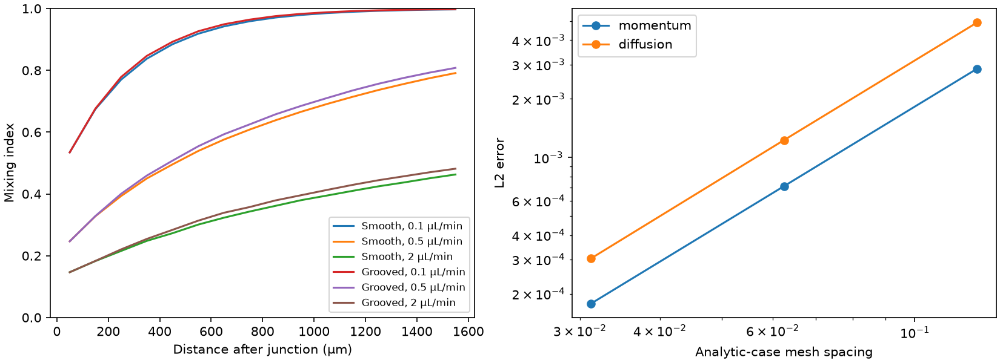
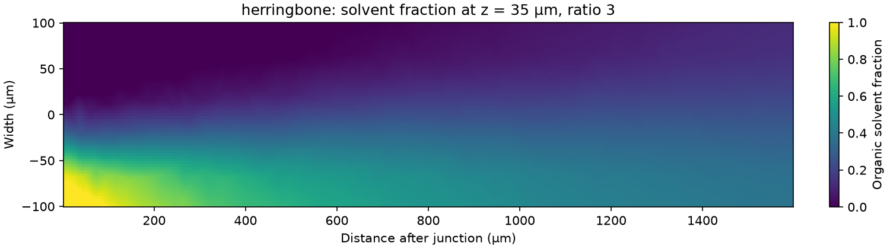

# Microfluidic mixing simulator

I built a small-channel mixing simulator because I wanted to see whether grooves actually help two liquid streams mix before they leave a chip. This matters for lipid nanoparticles: lipids dissolved in an organic solvent meet water, and the speed of solvent mixing affects the conditions where particles form.

I send the two streams through a Y-junction, then compare a smooth channel with one containing alternating herringbone grooves. The program solves the liquid motion and follows the solvent concentration. It saves pictures, a table of operating conditions, and a mixing score along the channel. A score of 1 means the solvent is evenly spread across a section.

To try it, install [micromamba](https://mamba.readthedocs.io/en/latest/installation/micromamba-installation.html), then run these commands from the repository folder on macOS or Linux:

```sh
micromamba create -y -f environment.yml
micromamba run -n microfluidic python -m pytest -q
OMP_NUM_THREADS=1 OPENBLAS_NUM_THREADS=1 micromamba run -n microfluidic python -m mixing.study --coarse --output quick-results
```

Open `quick-results/mixing-and-verification.png` and `quick-results/sweep.csv`. The quick run is a coarse check; the saved [full results](results/sweep.csv) use finer meshes and 18 operating conditions. I use open-source FEniCSx and Gmsh here, not COMSOL or ANSYS.



## Running my full comparison

```sh
OMP_NUM_THREADS=1 OPENBLAS_NUM_THREADS=1 micromamba run -n microfluidic python -m mixing.study --output my-results
```

The full run compares water-to-organic flow ratios of 1, 3 and 5, at total flow rates of 0.1, 0.5 and 2 microlitres per minute, for both channel shapes. It also runs analytic checks and refines both channel meshes. It runs on one processor; no GPU or commercial licence is needed. Keep the thread limits above to avoid unnecessary parallel work.

For a different operating window:

```sh
OMP_NUM_THREADS=1 OPENBLAS_NUM_THREADS=1 micromamba run -n microfluidic python -m mixing.study --rates 0.2 0.4 --ratios 2 4 --mesh 0.3 --output another-run
```

The analytic checks and mesh study retain their reference conditions. The model dimensions, liquid properties and groove definition are in [the model note](docs/model.md). Python writes all outputs under the selected folder and exits; it starts no server.

## What I learned

The grooves improve mixing modestly in this short channel. At a water-to-organic ratio of 3 and 0.5 µL/min, the saved sweep predicts an outlet score of **0.808 with grooves**, compared with **0.791 without them**. Slowing the flow gives diffusion more time and has a much larger effect than adding these grooves.

My [design note](docs/design.md) compares the geometry, mesh sensitivity and mixing time. I would use these results to choose the next simulation or experiment, rather than call this an optimized chip. The model follows solvent only: it does not predict nanoparticle size, loading or biological performance. At higher flow, numerical concentration overshoots also limit how confidently I can interpret the scores.



## Looking at the outputs

- `sweep.csv` contains one row per operating condition, including the outlet score, Reynolds and Peclet numbers, and concentration bounds. Reynolds number compares inertia with viscosity; Peclet number compares transport by flow with molecular diffusion.
- `sweep.json` includes every sampled cross section, its mean concentration and the mixing score. `t90_s` is the first sampled time reaching a score of 0.9; a blank CSV entry or JSON null means it was not reached inside this channel.
- `convergence.json` records how the outlet score changes as I refine the tetrahedral mesh, the small volume elements used by the solver.
- The PNG files show concentration, groove shape, transverse flow, verification error and mesh sensitivity.
- Each run writes `.xdmf` and `.h5` files for [ParaView](https://www.paraview.org/), a free 3D results viewer. Open the XDMF file to inspect concentration, pressure and velocity. These regenerable field files are not committed.
- `provenance.json` records solver versions, physical parameters and the requested sweep.

## How I checked the calculation

The flow solver uses three-dimensional Stokes flow, an approximation for slow, viscous motion. I use quadratic velocity and linear pressure finite elements, then solve a convection-diffusion equation for solvent with streamline stabilization. The equations, boundary conditions, index definition and limits are in [docs/model.md](docs/model.md).

All eight automated tests pass. They check coupled pressure and velocity against an exact parabolic channel-flow solution, second-order error reduction for reduced Poiseuille flow and 1D diffusion, inlet flow ratios, mass balance, transverse motion, uniform concentration preservation, section sampling and invalid inputs. The analytic diffusion error falls from 0.00492 to 0.000304 across two mesh halvings.

GitHub Actions runs the tests and a coarse two-geometry study on every push and pull request, and saves the generated figures and fields as an artifact. The committed full study is separate from this coarse CI check. I compare finite-device mixing times with the textbook diffusion scale, W²/D, rather than claiming the simulator validates nanoparticle production.
